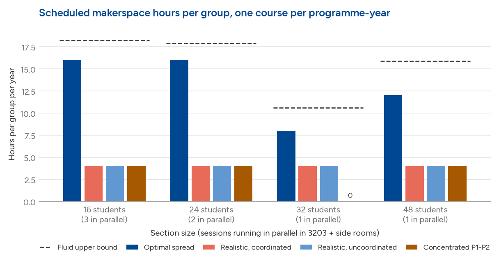
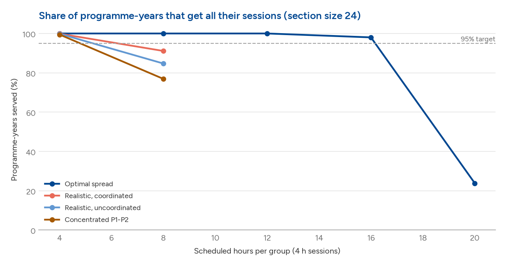
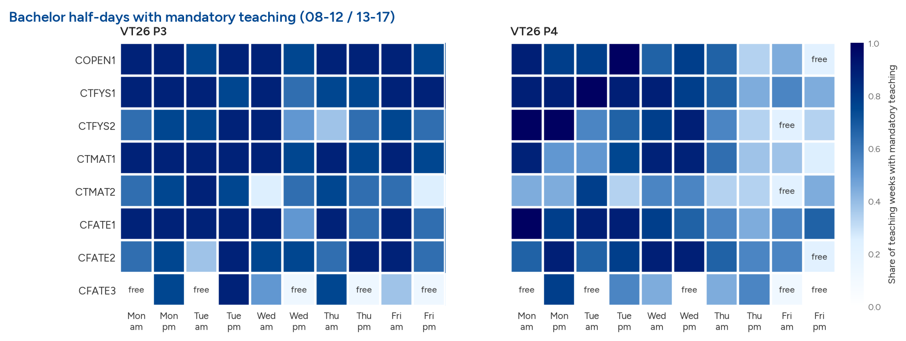
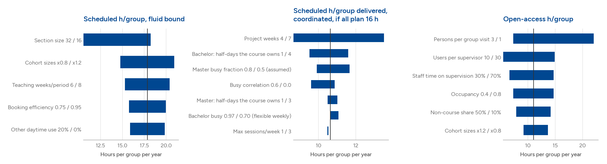

# SCI Makerspace: first-order throughput estimate

*Generated by `report.py` from `results/` (run `run.py` first). Monte Carlo draws:
200 for headline scenarios, 80 for sweeps and sensitivity.
All inputs are in `data/*.yaml`, each tagged with its source or marked as assumed.*

## Headline

The target is one makerspace project course per year for every SCI programme-year:
CTFYS, CTMAT and CFATE years 1–3, COPEN, and all 11 SCI master programmes in both years.
That is **32 programme-years, about 1,970 students, 505 project
groups of 4**, taught in supervised sections of 24. Room 3203 plus
the 3202 and 3D-studio side rooms takes 2 such sections at once, in
4 h daytime blocks.

> **Scheduled, supervised time (weekdays 08–17):**
> - **Spread optimally** over P1–P4 and the week: each programme-year can run
>   **1 course with ≈16 h of makerspace time per group** (fluid upper bound
>   17.85 h). This is the same capacity as 2 courses × 8 h.
> - **Realistic timetables, school-coordinated periods:** ≈**4 h guaranteed**.
>   If every course plans 16 h, groups get on average 10.5 h, and the
>   worst-served 5% get 5.6 h.
> - **Each programme picks its own period (uncoordinated):** ≈**4 h guaranteed**.
>   The average is 10.0 h, the worst 5% get 4.0 h.
> - **Concentrated in P1–P2:** ≈**4 h guaranteed**. The average is
>   9.4 h, the worst 5% get 4.0 h.
>
> **Self-booked open access (evenings and Saturdays):** about **11 h per group per year**
> on top of the scheduled time. This is limited by **makerspace staff hours**, not by space.
> The budgeted 1.3 FTE staff can cover about 20 of the 26
> documented open hours per week.

Put simply: under realistic conditions each programme-year can count on **4–10 h of
scheduled room time per group per year** (more only with school-level coordination and
projects spread through the period), **plus about 11 h** of open access. That can
be one course or two shorter ones. Even with perfect scheduling the planned space gives
under 18 h of supervised time per group if every programme-year is to have a course.

**Bachelor timetables are packed, and this is now measured.** VT26 and VT27-draft TimeEdit
data for years 1–2 show teaching in 70% of half-days on average,
but it moves from week to week. Only 0.7 of 10 half-days
are free in most weeks. A makerspace course therefore has to use **its own timetable
slots** (a median of about 2 half-days a week for a spring course), not free time. This
mostly lowers the guarantee and hits the big cohorts: CTFYS1–2, CFATE1 and COPEN groups get
8.4 h on average, against 12.3 h for the
masters, whose timetables are still assumed. Giving the makerspace course **3–4 half-days**
of its own, or using **2 h sessions** in timetable gaps, brings the guarantee back to about
8 h (see "Bachelor timetables" below).

"Guaranteed" means at least 95% of programme-years get every
session they planned. Sessions are 4 h blocks, so guaranteed values move in 4 h steps.
"Mean if every course plans 16 h" is the hours actually delivered when every course
asks for 16 h and the timetable squeezes some of them.

## Scenarios (section size 24)

| Scenario | What it assumes | Guaranteed Y (h/group, ≥95% of programme-years) | Mean h/group if every course plans 16 h | Worst 5% get (h) |
|---|---|---|---|---|
| Optimal spread | School-coordinated period allocation, no timetable conflicts, sessions anywhere in the 7 teaching weeks | 16 | 16.0 | 16.0 |
| Realistic, coordinated | School balances courses over P1-P4; bachelor cohorts only free in the makerspace course's own ~2 half-days/week (measured), masters ~70% busy (assumed); project sessions in the last 5 weeks of the period | 4 | 10.5 | 5.6 |
| Realistic, uncoordinated | As coordinated, but each programme picks its period independently (uniformly at random) | 4 | 10.0 | 4.0 |
| Concentrated P1-P2 | As uncoordinated, but 70% of courses land in P1-P2 (AppE §8.1 expects an autumn peak) | 4 | 9.4 | 4.0 |

**Where the capacity goes.** Starting from the optimal case, these are the steps that cost
the most (see `results/sensitivity.csv`):

1. **Project work bunched in the last weeks of each period.** If every course uses only
   the last 5 of
   7 weeks, the first weeks of every period
   stand empty. This is the largest single loss.
2. **Busy cohort timetables.** Bachelor cohorts years 1–2 are effectively free only in the
   makerspace course's own slots (measured, see below). Master cohorts are assumed free in
   about 30% of daytime blocks. Free blocks partly coincide between programmes.
3. **No period coordination, or an autumn peak.** This makes period loads uneven. It hits
   the large cohorts hardest: CTFYS-2, CTFYS-1, CTFYS-3, COPEN-1, CFATE-3 fare worst in the concentrated scenario.
   Each needs 5–6 sections squeezed into the cohort's few free half-days.

## Bachelor timetables (measured)

Data source: the schedule reviews at
<https://cohm.github.io/kth-schedule-review/docs/examples/>.
- Every teaching occasion for CTFYS, CTMAT and CFATE years 1–3 and COPEN, VT26 and the
  VT27 draft, from TimeEdit.
- Course categories come from the study plans in `cohm/ProgramVisualization`.
- Parsed by `tools/schedule_from_review.py` and measured by `tools/schedule_analysis.py`.
- Teaching weeks only; exams and exam weeks excluded. Mandatory courses, averaged over
  P3/P4 and both terms.

| Programme-year | Scheduled h/week (08–17) | Half-days with teaching | Half-days free in ≥75% of weeks (of 10) | 2 h slots free in ≥75% of weeks (of 20) |
|---|---|---|---|---|
| COPEN1 | 20.9 | 74% | 0.5 | 5.2 |
| CTFYS1 | 21.0 | 77% | 0.2 | 4.8 |
| CTFYS2 | 18.6 | 68% | 0.5 | 4.8 |
| CTFYS3 | 0.0 | 0% | 10.0 | 20.0 |
| CTMAT1 | 18.8 | 73% | 0.5 | 7.8 |
| CTMAT2 | 11.3 | 51% | 2.2 | 12.5 |
| CTMAT3 | 0.6 | 3% | 10.0 | 20.0 |
| CFATE1 | 20.6 | 74% | 0.2 | 5.5 |
| CFATE2 | 20.6 | 72% | 0.5 | 3.8 |
| CFATE3 | 6.9 | 32% | 5.2 | 14.5 |

- **Years 1–2 and COPEN: scheduled almost every half-day.** Mandatory teaching averages
  18.8 h/week. The schedule is not dense, but it is spread out:
  a 2 h lecture or exercise in most half-days. Only 0.7
  half-days per week are free week after week, at most 4.
  For a slot that has to recur weekly, the effective busy fraction is about
  0.93, not the 0.70 the average suggests.
  Two-hour gaps are more common: 6.3 of 20 two-hour slots are
  regularly free.
- **The makerspace course must bring its own slots.** A typical spring course has about
  6 h/week in about 2 regular half-days. A big cohort is then capped even before other
  programmes compete for the room. For example, CTFYS1 with 6 sections of 24, 2 sections in
  the room at once and 2 half-days a week gets 4 section-sessions a week. That is about
  13 h per group over a 5-week project phase.
- **Year 3 (spring): almost no mandatory teaching.** CTFYS3 and CTMAT3 have none, CFATE3
  has about 7 h/week. Students follow electives and the bachelor thesis (SA114X, SA115X,
  SA120X, MF131X), which already have 40–57 scheduled "Projektarbete" occasions each. The
  thesis is a natural vehicle for year-3 makerspace projects; the model treats year 3 like
  years 1–2, which is conservative.
- **Correlation between programmes** of busy half-days is -0.01
  to 0.38, consistent with the 0.3 assumed.
- **Masters and autumn:** there is no timetable data for these. Master cohorts keep the
  assumed 70% busy with 2 owned half-days, and autumn is assumed to look like spring.

**What it does to the results (coordinated scenario):**

| Bachelor timetable assumption (coordinated scenario) | Guaranteed h | Served at 8 h | Mean if plan 16 h | Worst 5% | Bachelor mean | CTFYS1-2, CFATE1, COPEN mean | Master mean |
|---|---|---|---|---|---|---|---|
| Before calibration: bachelor 70% busy, varying week to week | 8 | 0.958 | 11.1 | 6.7 | 9.9 | 9.5 | 12.3 |
| Measured, recurring weekly slot, course owns 2 half-days (default) | 4 | 0.914 | 10.6 | 6.0 | 9.1 | 8.4 | 12.3 |
| Measured, course owns 1 half-day | 4 | 0.757 | 9.5 | 3.3 | 6.0 | 5.4 | 13.3 |
| Measured, course owns 3 half-days | 8 | 0.979 | 11.3 | 7.2 | 10.3 | 10.0 | 12.3 |
| Measured, course owns 4 half-days | 8 | 0.993 | 11.6 | 8.0 | 10.8 | 10.6 | 12.4 |
| Measured, 2 h sessions in timetable gaps (course owns 3 x 2 h) | 8 | 0.99 | 11.2 | 8.7 | 10.5 | 10.3 | 12.0 |

## Concrete proposals: CTFYS

These three courses are pinned to their real periods and timetable slots in
`data/course_plans.yaml`. All other programme-years stay generic, in the coordinated
scenario.

1. **SK1105 Experimentell fysik** (CTFYS1, P4): replace 1–2 of the 4 three-hour labs with a
   makerspace project, planned at 8 h per group. The labs already run as sessions of about
   24 students on Tue and Wed, mornings and afternoons, in weeks 2–7 (VT26 and VT27). So
   the course owns 4 half-days a week for the whole cohort.
2. **SE1055 Hållfasthetslära** (CTFYS2, P3): a project in place of some exercise sessions,
   8 h. It uses the course's 4 regular half-days in VT27 P3, weeks 3–7. These are
   whole-cohort lecture and exercise slots. **SG1113** (P1) is the alternative, but autumn
   timetables aren't in the data.
3. **Year 3:** replace one of the four labs with a bigger project. Students build a
   measurement device, calibrate it, then go and measure something with it; 12 h in the
   makerspace. I assumed the course is SH1015 Tillämpad modern fysik in P1, the mandatory
   year-3 course with labs. Its slots are unknown, so it gets 2 generic half-days.

Each cell shows mean hours delivered of the hours planned, with the share of simulated
timetables in which every section got everything in brackets. "Others plan" is what
every other programme-year asks for. 16 h is a stress test that over-asks the room.

| Others plan | Variant | CTFYS1: SK1105 | CTFYS2: SE1055 | CTFYS3: measurement device |
|---|---|---|---|---|
| 8 h | As proposed: SK1105 8 h, SE1055 8 h, year-3 device 12 h | 8.0 of 8 h (100%) | 8.0 of 8 h (98%) | 9.3 of 12 h (15%) |
| 8 h | SK1105 at 12 h | 11.9 of 12 h (95%) | 7.9 of 8 h (94%) | 9.3 of 12 h (9%) |
| 8 h | Year-3 course owns 3 half-days | 8.0 of 8 h (100%) | 8.0 of 8 h (99%) | 11.1 of 12 h (56%) |
| 8 h | Year-3 course owns 4 half-days | 8.0 of 8 h (98%) | 8.0 of 8 h (95%) | 11.7 of 12 h (84%) |
| 8 h | Year-3 owns 3 half-days, project over all 7 weeks | 8.0 of 8 h (98%) | 7.8 of 8 h (91%) | 12.0 of 12 h (96%) |
| 12 h | As proposed: SK1105 8 h, SE1055 8 h, year-3 device 12 h | 7.9 of 8 h (94%) | 7.3 of 8 h (65%) | 7.5 of 12 h (2%) |
| 12 h | SK1105 at 12 h | 11.0 of 12 h (56%) | 7.2 of 8 h (62%) | 7.9 of 12 h (1%) |
| 12 h | Year-3 course owns 3 half-days | 7.9 of 8 h (91%) | 7.3 of 8 h (66%) | 9.2 of 12 h (14%) |
| 12 h | Year-3 course owns 4 half-days | 7.8 of 8 h (90%) | 7.4 of 8 h (65%) | 10.0 of 12 h (39%) |
| 12 h | Year-3 owns 3 half-days, project over all 7 weeks | 7.9 of 8 h (94%) | 7.3 of 8 h (69%) | 11.4 of 12 h (68%) |
| 16 h | As proposed: SK1105 8 h, SE1055 8 h, year-3 device 12 h | 7.6 of 8 h (75%) | 6.0 of 8 h (35%) | 6.7 of 12 h (0%) |
| 16 h | SK1105 at 12 h | 10.3 of 12 h (39%) | 5.8 of 8 h (29%) | 6.8 of 12 h (0%) |
| 16 h | Year-3 course owns 3 half-days | 7.5 of 8 h (80%) | 6.1 of 8 h (29%) | 7.7 of 12 h (5%) |
| 16 h | Year-3 course owns 4 half-days | 7.4 of 8 h (68%) | 6.3 of 8 h (31%) | 7.6 of 12 h (6%) |
| 16 h | Year-3 owns 3 half-days, project over all 7 weeks | 7.6 of 8 h (78%) | 6.4 of 8 h (38%) | 10.6 of 12 h (45%) |

- **SK1105 is close to an ideal vehicle.** 8 h fits in
  100% of timetables when the others keep to 8 h, and still
  94% when they ask for 12 h. Even 12 h in SK1105 fits
  (95%) if the others keep to 8 h. The course
  already works in lab-sized sections and owns 4 half-days, so the makerspace only replaces
  the lab room.
- **SE1055 at 8 h works if the others keep to about 8 h**
  (98%). It gets tight at 12 h
  (65%), because its six sections must share four
  fixed half-days in which other programme-years also want the room.
- **The year-3 device project does not fit as a 12 h block in 2 half-days at the end of
  the period** (15% fully served). It fits when the course
  owns 3 half-days and the project runs through the whole period
  (96% with others at 8 h,
  68% at 12 h). Only building and calibrating need the
  makerspace; the measuring can happen elsewhere, so 8 h in the room plus open access may
  be enough.
- **All of this needs an allocation rule.** When every programme-year asks for 16 h, even
  SK1105 at 8 h gets everything in only 75% of timetables.
  A fair-share cap of about 8 h per course, plus booked exceptions for courses like these,
  is consistent with the capacity estimates above.

## Section size matters, non-linearly

| Section size | Sections | Parallel | Fluid bound | optimal | coordinated | uncoordinated | concentrated |
|---|---|---|---|---|---|---|---|
| 16 | 141 | 3 | 18.23 | 16 | 4 | 4 | 4 |
| 24 | 96 | 2 | 17.85 | 16 | 4 | 4 | 4 |
| 32 | 81 | 1 | 10.58 | 8 | 4 | 4 | 0 |
| 48 | 54 | 1 | 15.87 | 12 | 4 | 4 | 4 |

Sections of 16–24 let 2–3 sections share the course space at once. A section of 32 runs
alone and leaves about a third of 3203's 50 places unused. Whole-class sessions of 48 are better than 32
but poorer than 24. **Plan sections at ≤24 students, or ≈48.**

## Per programme-year

Mean scheduled hours per group if every course plans 16 h:

| Cohort | Programme | Students | Sections (S=24) | Groups | Optimal | Coordinated | Uncoordinated | Concentrated P1-P2 |
|---|---|---|---|---|---|---|---|---|
| COPEN-1 | Öppen ingång (1 yr) | 99 | 5 | 25 | 16.0 | 9.4 | 8.5 | 7.9 |
| CTFYS-1 | Teknisk fysik | 142 | 6 | 36 | 16.0 | 8.0 | 7.4 | 7.1 |
| CTFYS-2 | Teknisk fysik | 131 | 6 | 33 | 16.0 | 7.4 | 7.4 | 6.9 |
| CTFYS-3 | Teknisk fysik | 124 | 6 | 31 | 16.0 | 8.2 | 7.1 | 7.2 |
| CTMAT-1 | Teknisk matematik | 75 | 4 | 19 | 16.0 | 10.1 | 9.4 | 9.2 |
| CTMAT-2 | Teknisk matematik | 68 | 3 | 17 | 16.0 | 11.0 | 11.1 | 10.6 |
| CTMAT-3 | Teknisk matematik | 65 | 3 | 17 | 16.0 | 11.2 | 11.5 | 10.8 |
| CFATE-1 | Farkostteknik | 114 | 5 | 29 | 16.0 | 9.3 | 8.1 | 8.2 |
| CFATE-2 | Farkostteknik | 103 | 5 | 26 | 16.0 | 9.1 | 8.6 | 8.3 |
| CFATE-3 | Farkostteknik | 98 | 5 | 25 | 15.9 | 8.4 | 8.2 | 7.9 |
| TTFYM-1 | Engineering Physics | 75 | 4 | 19 | 16.0 | 10.2 | 9.6 | 9.4 |
| TTFYM-2 | Engineering Physics | 71 | 3 | 18 | 15.9 | 11.3 | 11.0 | 11.0 |
| TAEEM-1 | Aerospace Engineering | 87 | 4 | 22 | 16.0 | 10.4 | 10.0 | 9.3 |
| TAEEM-2 | Aerospace Engineering | 83 | 4 | 21 | 16.0 | 10.7 | 9.9 | 8.9 |
| TFORM-1 | Vehicle Engineering | 51 | 3 | 13 | 16.0 | 11.6 | 11.4 | 10.3 |
| TFORM-2 | Vehicle Engineering | 48 | 2 | 12 | 16.0 | 13.5 | 12.5 | 11.1 |
| TJVTM-1 | Railway Engineering (TFORM track HT26) | 22 | 1 | 6 | 16.0 | 13.5 | 13.0 | 12.1 |
| TJVTM-2 | Railway Engineering (TFORM track HT26) | 21 | 1 | 6 | 16.0 | 13.2 | 13.5 | 12.1 |
| TMRSM-1 | Naval Architecture | 22 | 1 | 6 | 16.0 | 13.6 | 13.0 | 12.0 |
| TMRSM-2 | Naval Architecture | 21 | 1 | 6 | 16.0 | 13.4 | 12.8 | 11.7 |
| TTEMM-1 | Engineering Mechanics | 47 | 2 | 12 | 16.0 | 13.1 | 12.9 | 12.1 |
| TTEMM-2 | Engineering Mechanics | 45 | 2 | 12 | 16.0 | 12.7 | 12.8 | 11.3 |
| TTMAM-1 | Applied & Computational Mathematics | 41 | 2 | 11 | 15.9 | 12.9 | 12.2 | 11.7 |
| TTMAM-2 | Applied & Computational Mathematics | 39 | 2 | 10 | 16.0 | 12.9 | 12.4 | 11.5 |
| CSSE-1 | Computer Simulations (TTMAM track) | 37 | 2 | 10 | 15.9 | 13.5 | 12.3 | 11.5 |
| CSSE-2 | Computer Simulations (TTMAM track) | 35 | 2 | 9 | 16.0 | 13.1 | 12.6 | 11.8 |
| TNEEM-1 | Nuclear Energy Engineering | 37 | 2 | 10 | 16.0 | 13.4 | 12.7 | 11.8 |
| TNEEM-2 | Nuclear Energy Engineering | 35 | 2 | 9 | 16.0 | 12.9 | 12.4 | 11.3 |
| TBDVM-1 | Biostatistics & Data Science (joint KI) | 42 | 2 | 11 | 15.9 | 13.7 | 11.9 | 11.1 |
| TBDVM-2 | Biostatistics & Data Science (joint KI) | 39 | 2 | 10 | 16.0 | 13.1 | 12.6 | 12.1 |
| MATH-1 | Mathematics (joint SU) — PLACEHOLDER | 27 | 2 | 7 | 16.0 | 12.8 | 12.6 | 11.1 |
| MATH-2 | Mathematics (joint SU) — PLACEHOLDER | 26 | 2 | 7 | 16.0 | 13.0 | 12.5 | 11.4 |

## Open access and machines

| Opening hours | Staffing | Staff FTE | Student-assistant FTE | Open h/week wanted | Open h/week staffed | Binding limit | Max users at once | Z (h/group/yr) |
|---|---|---|---|---|---|---|---|---|
| documented | budgeted | 1.3 | 1.0 | 26 | 19.5 | staff | 40 | 11.0 |
| documented | matched | 1.73 | 1.0 | 26 | 26.0 | opening hours | 40 | 14.7 |
| extended | budgeted | 1.3 | 1.0 | 56 | 19.5 | staff | 40 | 11.0 |
| extended | matched | 3.73 | 1.87 | 56 | 56.0 | opening hours | 40 | 31.7 |

- **Staffing binds before space.** Budgeted staffing gives about 20 open
  hours a week. Covering all documented evening and Saturday hours (17–21, Sat 10–16)
  needs about 1.73 staff FTE. The Education
  deck's extended hours (17–23, weekends 10–23) need about
  3.73 staff FTE plus
  1.87 student-assistant FTE, and would
  give about 32 h per group.
- This assumes App E's evening rule of 1 staff + 1 student assistant per open hour, with
  50% of staff time available for supervision.

| Resource | Supply h/yr | Demand h/yr | Utilisation | Max h per using group |
|---|---|---|---|---|
| 3D printers | 12240.0 | 4040.0 | 0.33 | 24.24 |
| CNC | 680.0 | 454.5 | 0.67 | 4.49 |
| Metal machines | 2720.0 | 606.0 | 0.22 | 17.95 |

- **The single desktop CNC is the first machine bottleneck.** At
  67% utilisation it allows only about
  4.5 h for each group that needs it. It is also daytime-only.
  A second bench CNC, as the Plan already lists ("(2)"), would roughly double this.
- **3D printers are not a bottleneck** at 33% utilisation for
  8 printer-hours per group.

## Sensitivity

| Output | Parameter (low case / high case) | Base | Low case | High case |
|---|---|---|---|---|
| Scheduled, fluid bound | Cohort sizes x0.8 / x1.2 | 17.85 | 14.77 | 20.9 |
| Scheduled, fluid bound | Section size 32 / 16 | 17.85 | 10.58 | 18.23 |
| Scheduled, fluid bound | Booking efficiency 0.75 / 0.95 | 17.85 | 15.75 | 19.95 |
| Scheduled, fluid bound | Other daytime use 20% / 0% | 17.85 | 15.87 | 19.83 |
| Scheduled, fluid bound | Teaching weeks/period 6 / 8 | 17.85 | 15.3 | 20.4 |
| Open access Z | Cohort sizes x1.2 / x0.8 | 11.03 | 9.19 | 13.68 |
| Open access Z | Occupancy 0.4 / 0.8 | 11.03 | 7.35 | 14.7 |
| Open access Z | Non-course share 50% / 10% | 11.03 | 7.88 | 14.18 |
| Open access Z | Persons per group visit 3 / 1 | 11.03 | 7.35 | 22.06 |
| Open access Z | Staff time on supervision 30% / 70% | 11.03 | 6.62 | 14.7 |
| Open access Z | Users per supervisor 10 / 30 | 11.03 | 5.51 | 14.89 |
| Scheduled, delivered (coordinated, plan 16 h) | Bachelor: half-days the course owns 1 / 4 | 10.64 | 9.51 | 11.6 |
| Scheduled, delivered (coordinated, plan 16 h) | Bachelor busy 0.97 / 0.70 (flexible weekly) | 10.64 | 10.63 | 11.07 |
| Scheduled, delivered (coordinated, plan 16 h) | Master busy fraction 0.8 / 0.5 (assumed) | 10.64 | 9.91 | 11.67 |
| Scheduled, delivered (coordinated, plan 16 h) | Project weeks 4 / 7 | 10.64 | 8.65 | 13.52 |
| Scheduled, delivered (coordinated, plan 16 h) | Busy correlation 0.6 / 0.0 | 10.64 | 9.6 | 10.87 |
| Scheduled, delivered (coordinated, plan 16 h) | Master: half-days the course owns 1 / 3 | 10.64 | 10.49 | 11.02 |
| Scheduled, delivered (coordinated, plan 16 h) | Max sessions/week 1 / 3 | 10.64 | 10.53 | 10.47 |

## Method (first-order)

1. **Fluid bound** (`model/capacity.py`). Supply in section-hours is periods × room-hours
   per period × parallel sections. Room-hours per period are
   7 weeks × 5 days ×
   8 h × 0.85 booking
   efficiency × (1 − 0.1 other use) =
   214.2 h. Parallel sections are
   ⌊(50 + 8 + 4) / (24 + 1)⌋ = 2.
   So supply = 4 × 214.2 × 2 =
   1714 section-hours, shared by 96 sections,
   which gives **Y_max = 17.85 h**.
2. **Timetable simulation** (`model/schedule.py`).
   - Each programme-year is placed in a period: balanced by the school, or chosen at random.
   - It gets a weekly busy mask from its other teaching, with at least
     2 free blocks guaranteed,
     since the makerspace course is one of its own courses.
   - Its sections are packed greedily into free 3203 slots, at most
     2 sessions per section per week, preferring the
     least-contested slot.
   - This is repeated over many random timetables. The greedy packing is a heuristic: a
     skilled human scheduler might do slightly better, but cannot beat the fluid bound.
   - Check: with no conflicts and every course over-asking, the simulation delivers the
     fluid bound to within 3% (`tests/test_model.py`).
3. **Open access** (`model/open_access.py`).
   - Staffed open hours per week = min(wanted hours, staff hours available, student-assistant
     hours available).
   - Users at once = min(room capacity, users per supervisor × supervisors). Occupancy and
     non-course use are discounted, and the result is divided by persons present per group visit.
   - Machine-hours per year are compared against the demand per group.

## Caveats: replace these first

- **Cohort sizes.** Year-1 and external-master numbers are UHR admission figures, not
  registrations. Year-2/3 retention, COPEN inflow, master show-up rate and the internal flow
  from civilingenjör year 3 into SCI masters are all assumptions (`data/cohorts.yaml`). The
  joint Mathematics master is a placeholder. Registered numbers per programme-year from
  SCI study administration (Ladok) would remove the largest uncertainty.
- **Project weeks and master timetables** now drive the realistic scenarios. Bachelor
  timetables are measured for spring only. Master timetables (TimeEdit) and the autumn
  periods would complete the calibration.
- **Not modelled:**
  - scheduled course sessions in the evening
  - the AlbaNova satellite
  - Alt 2 (377 m²)
  - student-team use of 3203 beyond the 10% "other use"
  - safety-induction load (small: about 1.5 h per new student, in groups)
  - courses whose project needs more than one programme-year's slot
- **Where the documents disagree, these choices were made:**
  - 3203's 50-person limit is taken as binding for sessions
  - Appendix E's opening hours are the documented case; the Education deck's hours are the extended case
  - only 1 desktop CNC is counted, since only one is budgeted
